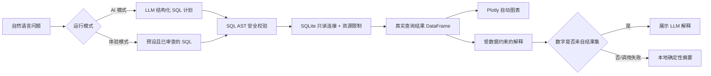

# RetailMind

基于 LLM 的零售业务智能问数助手（Text-to-SQL Agent）。用户用中文提出销售分析问题，RetailMind 生成并校验 SQLite 查询、执行真实数据检索、自动绘图，并且只基于查询结果给出解释。

> 当前版本：`0.1.0` MVP。数据为确定性生成的合成零售数据，不代表任何真实企业。

## 功能亮点

- **完整核心链路**：自然语言 → 结构化 SQL 计划 → AST 安全校验 → 只读 SQLite → Plotly 图表 → 数据解释。
- **无需 API Key 也能演示**：6 个预设业务问题会执行真实 SQLite 查询；界面明确标记此时不是实时 LLM 生成。
- **纵深 SQL 防护**：单语句 SELECT-only、表白名单、JOIN/CTE 上限、只读数据库 URI、SQLite authorizer、结果行数/超时/VM 步数限制。
- **防止解释“编数据”**：LLM 只能看到 SQL 实际结果；若解释包含结果集之外的数字，会被拦截并回退到本地确定性摘要。
- **可复现数据**：脚本使用固定随机种子，可重建 CSV 与 SQLite 数据库。

## 界面与真实截图

应用已提供深色专业仪表盘、查询反馈、结果图表、数据明细下载和 SQL 安全审计页。仓库内的截图脚本会启动真实浏览器、执行默认演示问题后再截图，不生成静态 mockup。

```bash
# 先在终端 A 启动应用
streamlit run app.py

# 再在终端 B 安装一次浏览器并截图
pip install playwright
playwright install chromium
python scripts/capture_screenshot.py
```

成功后文件位于 `docs/screenshots/retailmind-demo.png`。完整展示流程见 [docs/DEMO.md](docs/DEMO.md)。

## 快速启动

### 1. 创建环境并安装依赖

```bash
python -m venv .venv
source .venv/bin/activate          # Windows: .venv\Scripts\activate
pip install -r requirements.txt
```

建议使用 Python 3.10 及以上版本。

### 2. 直接体验（无需 API Key）

仓库已包含 `data/retailmind.db` 和示例 CSV，可直接运行：

```bash
streamlit run app.py
```

浏览器打开 `http://localhost:8501`。在侧边栏选择“体验模式（无需 Key）”，选择问题并点击“运行分析”。

体验模式的 SQL 来自 `retailmind/demo.py` 中经过审查的映射，不是 LLM 实时生成；查询、图表和摘要仍使用真实数据库结果。

### 3. 启用实时 LLM Text-to-SQL

```bash
cp .env.example .env
```

编辑 `.env`：

```dotenv
OPENAI_API_KEY=你的密钥
OPENAI_MODEL=gpt-6-astra
```

密钥仅从环境变量或本地 `.env` 读取，`.env` 已加入 `.gitignore`。模型名可按账号可用模型调整。实现使用 OpenAI Python SDK 的结构化输出生成 SQL 计划，并使用 Responses API 生成结果解释。

重新启动应用后，侧边栏会出现“AI 模式（实时生成）”。

## 架构



核心代码职责：

| 模块 | 职责 |
| --- | --- |
| `retailmind/llm.py` | 结构化 SQL 生成、LLM 解释、数字归因校验、确定性回退 |
| `retailmind/sql_guard.py` | SQLGlot AST 解析、只读节点和复杂度校验、表白名单 |
| `retailmind/database.py` | SQLite 只读执行、authorizer、超时/步数/行数限制 |
| `retailmind/charts.py` | 根据维度、指标与时间字段自动选择折线图或柱状图 |
| `retailmind/demo.py` | 无 Key 体验模式的 6 个可验证业务问题 |
| `retailmind/service.py` | 编排完整分析链路 |
| `app.py` | Streamlit Web UI |

## 数据集

数据区间为 `2024-01-01` 至 `2025-12-31`：

| 表 | 行数 | 说明 |
| --- | ---: | --- |
| `customers` | 240 | 客户、城市、地区、客群、注册日期 |
| `products` | 28 | 商品、品类、子类、售价、成本 |
| `orders` | 1,800 | 订单日期、状态、渠道、支付方式 |
| `order_items` | 4,321 | 商品、数量、成交单价、折扣率 |

业务口径：

- 销售额 = `quantity × unit_price × (1 - discount_rate)`
- 毛利润 = `quantity × (折后单价 - cost_price)`
- 销售分析默认仅统计 `orders.status = '已完成'`
- “最近/过去”类问题以数据最大日期为锚点，而不是机器当前日期

重新生成完全相同的数据：

```bash
python scripts/generate_data.py
```

## SQL 安全设计

1. SQLGlot 解析 SQLite AST，只接受一条 `SELECT` 或 `WITH ... SELECT`。
2. 拒绝 DDL、DML、PRAGMA、命令节点、多语句、注释与递归 CTE。
3. 仅允许 `customers`、`products`、`orders`、`order_items` 四张表。
4. 限制 JOIN 与 CTE 数量，防止模型生成异常复杂查询。
5. SQLite 使用 `mode=ro` 打开，并启用 `query_only` 与 authorizer。
6. progress handler 同时限制执行时间和 SQLite VM 步数。
7. 外层包装 `LIMIT`，默认最多物化 500 行。

安全校验不是数据库权限体系的替代品。若未来接入生产数仓，应继续使用最小权限只读账号、查询网关、审计日志与成本控制。

## 测试

```bash
pytest -q
```

当前测试覆盖：

- 危险 SQL、多语句、递归 CTE、未知表拒绝
- 只读执行与结果截断
- 数据库完整性和固定数据量
- 6 个演示问题全部真实执行
- 结果摘要的数据落地性
- Streamlit 首页加载和默认问题端到端交互

本仓库本地验证结果为 `21 passed`。你可以通过上面的命令复核。

## 项目结构

```text
RetailMind/
├── app.py
├── retailmind/
│   ├── charts.py
│   ├── config.py
│   ├── database.py
│   ├── demo.py
│   ├── llm.py
│   ├── service.py
│   └── sql_guard.py
├── data/
│   ├── retailmind.db
│   ├── customers.csv
│   ├── products.csv
│   ├── orders.csv
│   └── order_items.csv
├── scripts/
│   ├── capture_screenshot.py
│   └── generate_data.py
├── tests/
├── docs/DEMO.md
├── .env.example
└── requirements.txt
```

## 限制与后续方向

- MVP 只支持 SQLite，未实现多租户和真实企业权限模型。
- 实时 AI 模式需要用户自己的 API Key；自动测试不会发起付费 API 请求。
- 数字校验能阻止解释引入结果集之外的数值，但定性表述仍应结合 SQL 与明细复核。
- 可继续增加语义层、SQL 自动修复、查询历史、图表配置和评测集。

## License

[MIT](LICENSE)
